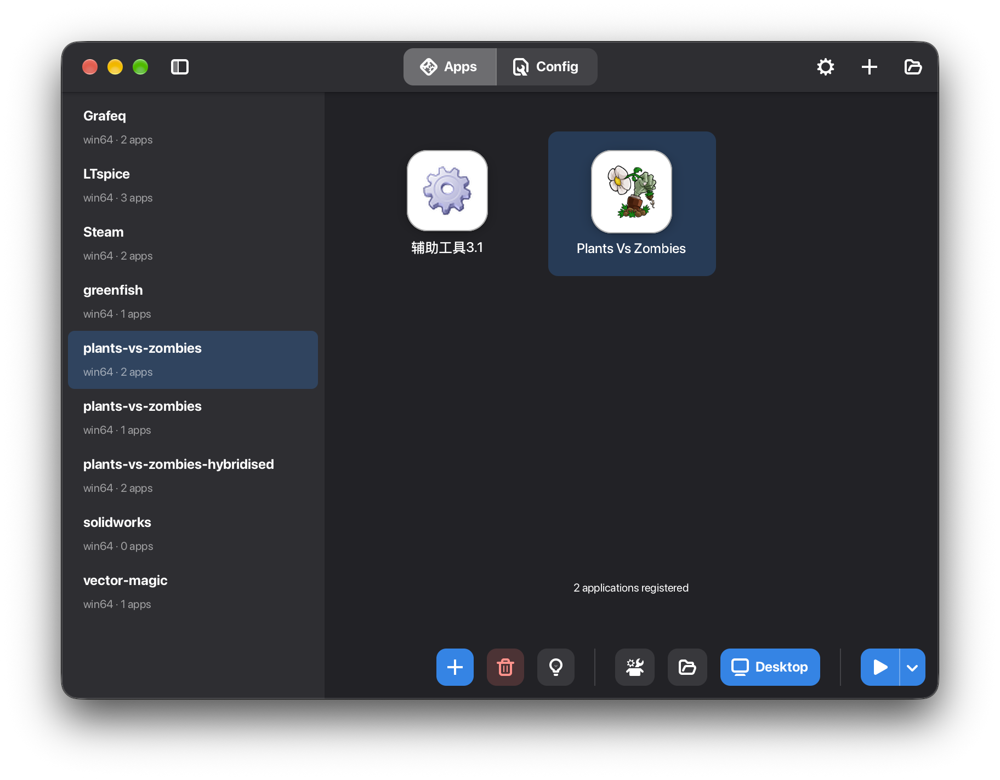

# Tequila 🥃

A modern, user‑friendly GUI application for managing Wine prefixes (also known as "Wine bottles")—built with Rust and [Relm4](https://relm4.org/) / libadwaita.

Tequila simplifies working with Wine on **macOS** and **Linux** by providing an intuitive interface to create, organize, and launch isolated Windows environments. It also includes a full registry editor, application scanner, Wine runtime manager, and a headless CLI for scripting.

---

## Features

### 🍷 Prefix Management
- **Create, delete, import & export** Wine prefixes (win32/win64). Export produces compressed `.wtea` archives (zstd), optionally including user data; import restores configs and re‑initializes the prefix
- **Launch executables** with per‑executable environment variables, working directory, and forwarded CLI args
- **Run winecfg, regedit, uninstaller, and taskmgr** directly from the interface
- **Process tracker** monitors running Wine processes; launch buttons reflect active state
- **Desktop integration** — create/remove native launchers (macOS `.app` bundles in `~/Applications/Tequila/`, Linux `.desktop` files), open prefix in file manager / terminal

### 🧩 Wine Runtime Manager
- **Detect system Wine** (`wine --version` in `PATH`)
- **Kron4ek/Wine‑Builds**: browse and download any published Wine version from GitHub Releases (primary source on Linux)
- **CrossOver (Anson2251) builds**: CodeWeavers CrossOver‑based runtimes with optional DXMT integration, as `.tar.zst` archives
- **Homebrew integration** (macOS): install and manage `wine-stable`, `wine-devel`, `wine-staging` casks
- **Import existing Wine** installations from any directory
- **Switch Wine version** per prefix with automatic reinitialization
- **Download progress, cancellation, and error reporting** with actionable messages (rate‑limiting, missing binaries, VPN issues)
- **Optional GitHub API key** setting for authenticated API requests (avoids rate limits when listing releases)
- **GStreamer runtime** download / detection for macOS

### 🎨 Graphics Backends
- **DXMT** — DirectX Metal translation
- **D3DMetal** — DirectX 11/12 via Metal (including import from a local folder or Apple Game Porting Toolkit `.dmg`)
- **DXVK + VKD3D‑Proton** — DirectX via Vulkan, with bundled `dxvk.conf` defaults and state‑cache setup
- Automatic DLL symlink installation and registry override setup per prefix
- Global install/remove in **Settings → Graphics Backends**, per‑prefix activate/deactivate in the prefix config panel

### 🔧 Registry Editor
Full graphical registry editor built into the application:

- **General tab**: Windows version, D3D renderer, offscreen rendering mode, audio/graphics drivers, DLL overrides, virtual desktop, application‑specific settings
- **Graphics tab**: backend‑specific configuration
- **Platform tab**: macOS driver configuration, X11 settings
- **Fonts tab**: UI / shell dialog fonts and font substitutions
- **Hash‑based SQLite cache** for fast registry reads
- **File watcher** for live registry updates

### 📁 Application Scanner
- **Auto‑scan** prefixes for Windows executables
- **Icon extraction** from PE files (with `.icns` handling on macOS)
- **Metadata extraction**: version info, company name, description, imported modules
- **Desktop file scanning** on Linux
- **SQLite cache** for scanned executables and registry data

### 🖥️ Modern UI
- Built with **Relm4 0.11**, **GTK 4.10+**, **libadwaita 1.7+**
- **Internationalization** (English + Simplified Chinese, JSON‑based in `data/lang/`, with `scripts/check_i18n.py` for key coverage)
- **Settings window** with NavigationView subpages (Wine Runtime, Graphics Backends, General incl. GitHub key / language)
- **Debug console window** with live stdout/stderr streaming and stdin input
- **Error dialogs** for launch failures with actionable messages
- **macOS native** menu bar (AppKit), window controls, file dialogs (`NSSavePanel`), and Dock integration; bundled Cascadia Mono with monospace fallbacks

### ⌨️ Headless CLI
In addition to the GUI, the `tequila` binary supports scripting:

```sh
# Launch a registered exe (or .exe path) inside a prefix, forwarding extra args
tequila run <prefix-name-or-path> <exe-name-or-path> [-- args...]
tequila run --uuid <uuid-dir> <exe> [-- args...]

# Force GUI mode even with subcommand args
tequila --gui
tequila run myprefix myapp --gui
```

The CLI resolves prefixes under `~/Wine/` by display name (or UUID directory with `--uuid`), exits with the child process code, and handles `Ctrl‑C` forwarding.

---

## Requirements

- **Rust** (latest stable, edition 2024)
- **GTK 4** (≥ 4.10)
- **libadwaita** (≥ 1.7)
- **pkg-config**
- **zstd** — for compressed runtime / prefix archives
- **tar**, **xz** — for archive extraction
- **Wine** — either installed system‑wide (`wine` in `PATH`) or managed via the runtime downloader

> **On macOS**, managed runtimes come from Homebrew casks, Kron4ek/Wine‑Builds, or CrossOver (Anson2251) builds.
>
> **On Linux**, the Kron4ek downloader is the primary way to get managed Wine builds.

---

## Project Structure

Tequila is organized as a **Cargo workspace** with nine crates:

| Crate | Description |
|-------|-------------|
| [`base`](crates/base) | Core types: `PrefixConfig`, `RegisteredExecutable`, error types, `GraphicsBackend`, `GraphicsConfig`, and shared traits |
| [`prefix`](crates/prefix) | Prefix lifecycle: create, delete, export/import (`.wtea`), scan, launch executables, run winecfg/regedit/uninstaller, runtime env setup, process tracking, desktop integration |
| [`runtime`](crates/runtime) | Wine runtime management: Kron4ek + Anson2251/CrossOver downloaders, Homebrew cask support, archive extraction, graphics backend installation (DXMT, D3DMetal, DXVK+VKD3D), GStreamer download, GitHub API client |
| [`registry`](crates/registry) | Wine registry access via [`regashii`](https://crates.io/crates/regashii): `RegistryEditor`, hash‑based SQLite cache, `WineRegistry`, key constants, DLL override helpers |
| [`scan`](crates/scan) | Application scanner: PE icon extraction, metadata extraction, desktop file scanning |
| [`store`](crates/store) | Persistent storage: SQLite‑backed `PrefixStore`, JSON `Settings` persistence (runtimes, GitHub key, language) |
| [`service`](crates/service) | Application service layer: shared `AppService` state, config ops, launch ops, runtime ops, sync, terminal helpers — bridges UI/CLI and the domain crates |
| [`ui`](crates/ui) | GTK4/libadwaita UI: main window, prefix list/config, app manager, registry editor (general / graphics / platform / fonts tabs), runtime manager, settings window, debug console, i18n |
| [`tequila`](crates/tequila) | Binary entry point: GUI startup plus `tequila run` headless CLI, signal handling, logging |

```
tequila/
├── Cargo.toml              # Workspace root
├── crates/
│   ├── base/               # Core types and traits
│   ├── prefix/             # Prefix lifecycle, export/import, desktop integration
│   ├── runtime/            # Wine runtime & graphics backend management
│   ├── registry/           # Wine registry editing
│   ├── scan/               # Application scanning & icon extraction
│   ├── store/              # Persistence (SQLite + JSON)
│   ├── service/            # Shared AppService business logic
│   ├── ui/                 # GTK4/libadwaita UI
│   └── tequila/            # Binary entry point (GUI + CLI)
├── data/                   # Icons, GResource bundle, i18n JSON (en, zh-CN)
├── docs/                   # Design documents
├── scripts/                # bundle-macos.sh, bundle-appimage.sh, check_i18n.py
└── winetricks.sh           # Bundled winetricks
```

---

## Installation

### From Source

```sh
git clone https://github.com/Anson2251/tequila.git
cd tequila
cargo build --release
./target/release/tequila
```

### Prebuilt Releases

Tagged GitHub releases build distributables via [`.github/workflows/release.yml`](.github/workflows/release.yml):

- **macOS**: `tequila-<version>-macos-<arch>.tar.xz` (standalone `Tequila.app`) and optionally `.dmg`
- **Linux**: `tequila-<version>-linux-<arch>.AppImage`

Checksums are appended to the release notes automatically.

---

## Usage

1. **Launch Tequila** — the main window opens with an empty sidebar if no prefixes exist.
2. **Create a prefix** — use the "New Prefix" dialog to set a name and architecture (win32/win64).
3. **Select a prefix** — the prefix config panel opens, showing Wine version, graphics backend, and registered applications.
4. **Install a Wine runtime** — go to **Settings → Wine Runtime** to detect system Wine, download a managed runtime (Kron4ek, CrossOver, or Homebrew on macOS), or import an existing installation. Set a GitHub API key in Settings if you hit API rate limits.
5. **Switch Wine versions** — in the prefix config, click "Switch" to select a different runtime. The prefix will automatically reinitialize.
6. **Launch applications** — executables detected by the scanner appear under the Apps list. You can also register `.exe` files manually, create desktop launchers, or launch headlessly via `tequila run`.
7. **Edit the registry** — use the **Registry Editor** button to open the graphical registry editor (general, graphics, platform, fonts tabs).
8. **Back up / share** — use the prefix context menu to **Export** (`.wtea`) or **Import** a prefix archive.
9. **Debug** — open the debug console to watch live process output when diagnosing a launch.

### Screenshots



---

## Technical Highlights

- **Rust edition 2024** — full use of modern Rust features
- **Service layer** (`service` crate) — single `AppService` façade over prefix / runtime / scan / store, shared by GUI and CLI
- **Reactive UI** — Relm4's component model with `#[tracker::track]` for efficient updates
- **Async operations** — non‑blocking scanning, downloading (with progress + cancellation), and registry operations via `tokio`
- **Wine runtime abstraction** — uniform API over system Wine, Homebrew casks, Kron4ek builds, and CrossOver builds
- **Graphics backend pipeline** — automatic DLL symlinking, registry override injection, `dxvk.conf` + state‑cache provisioning, GPTK `.dmg` import for D3DMetal
- **SQLite persistence** — hash‑based registry cache and scanned‑executable cache via `rusqlite`
- **Comprehensive error handling** — user‑friendly error dialogs with actionable suggestions (rate‑limiting, missing binaries, VPN issues)
- **macOS integration** — native menus, file dialogs (`NSSavePanel`), Dock integration, `gdk4-macos`, and `.app` launchers under `~/Applications/Tequila/`
- **i18n from day one** — JSON translation files with a key‑coverage checker script

---

## Packaging

### macOS (.app + .dmg)

```sh
brew install dylibbundler
./scripts/bundle-macos.sh            # → dist/Tequila.app + tar.xz
./scripts/bundle-macos.sh --dmg      # additionally creates .dmg
./scripts/bundle-macos.sh --sign     # codesign + notarize (requires Developer ID)
open dist/Tequila.app
```

The script `cargo build --release`s, creates the `.app` skeleton with `Info.plist`, bundles GTK4/libadwaita dylibs via `dylibbundler`, copies GTK runtime resources (GdkPixbuf loaders, GLib schemas, Adwaita icons), wires a launcher with the correct `DYLD_LIBRARY_PATH` / `XDG_DATA_DIRS` / GTK env vars, and regenerates the pixbuf loaders cache. [`cargo-packager`](https://docs.crabnebula.dev/packager) config lives in `Packager.toml`, but the bash script is the recommended path for GTK apps. Without code‑signing, macOS will show a Gatekeeper dialog on first launch.

### Linux (AppImage)

```sh
./scripts/bundle-appimage.sh         # → dist/tequila-<version>-linux-<arch>.AppImage
```

Downloads `linuxdeploy` + the GTK plugin into `.tools/`, builds the release binary, assembles an AppDir with resources and runtime deps, and bundles GTK4/libadwaita.

### CI

On release publish (or manual dispatch), the `Release` workflow builds both artifacts and attaches them to the GitHub release with SHA‑256 checksums.

---

## Requirements Details

### System Dependencies

- **GTK 4** (≥ 4.10)
- **libadwaita** (≥ 1.7)
- **pkg-config**
- **zstd**
- **tar**, **xz**

**Debian/Ubuntu:**
```sh
sudo apt install libgtk-4-dev libadwaita-1-dev pkg-config zstd
```

**Fedora:**
```sh
sudo dnf install gtk4-devel libadwaita-devel pkg-config zstd
```

**Arch Linux:**
```sh
sudo pacman -S gtk4 libadwaita pkg-config zstd
```

**macOS (Homebrew):**
```sh
brew install gtk4 libadwaita pkg-config zstd dylibbundler
```

---

## Roadmap

### Done
- [x] Binary releases (Linux AppImage, macOS `.app` / `.dmg` via CI)
- [x] Prefix export/import as compressed (`.wtea`) archives
- [x] Application desktop shortcut creation (native launchers)
- [x] Headless `tequila run` CLI
- [x] i18n (English, Simplified Chinese)

### Short Term
- [ ] Windows executable drag‑and‑drop registration
- [ ] Unit and integration test coverage

### Medium Term
- [ ] Winetricks integration (GUI for installing libraries — `winetricks.sh` is already bundled)
- [ ] Prefix templates / starter configurations
- [ ] Online application database

### Long Term
- [ ] Plugin system
- [ ] Cloud prefix sharing
- [ ] Performance profiling and Wine debug log viewer (basic live‑output debug console exists)

---

## Contributing

Contributions are welcome! Please open an issue or submit a pull request.

Make sure your code follows standard Rust conventions and includes appropriate documentation. If you're adding a feature, consider updating the relevant design document in `docs/`. Run `scripts/check_i18n.py` when touching user‑visible strings to keep translation keys in sync.

---

## License

This project is licensed under the **GPLv3 License** — see the [LICENSE](LICENSE) file for details.

---

> **Tequila** — because managing Wine shouldn't give you a headache. 🥃
